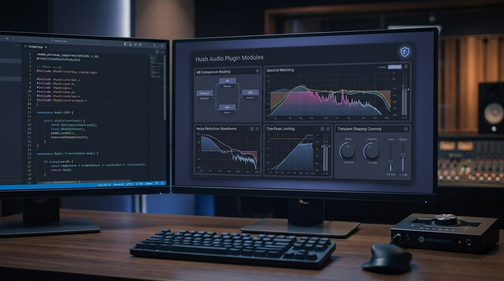

# Hush Audio Processing Modules 
Hush is a suite of privacy-focused, zero-telemetry audio processing plugins and modules built with a clean, native C++ architecture.
Repository: github.com/ljrseals-dev/hush-modules

## **Interface Preview**



The Hush user interface is designed for high-efficiency studio environments, providing a clean, distraction-free dark-mode workspace. The modular panel layout offers immediate visual feedback across core processing stages:
* **AB Comparison Routing**: Seamless reference switching and pipeline validation.
* **Spectral Matching**: Real-time frequency analysis and tonal curve matching.
* **Noise Reduction Waveforms**: Precision monitoring for spectral cleanup and artifact control.
* **True-Peak Limiting**: Transparent peak management and ceiling metering.
* **Transient Shaping Controls**: Dedicated parameters for attack, sustain, and edge definition.

## **Design Pillars**
 * **Zero Telemetry & Analytics**: Designed from the ground up to operate completely offline with an absolute absence of analytics, tracking SDKs, or external network calls.
 * **High-Performance C++ Architecture**: Engineered for low-latency, real-time audio execution and multi-track scalability.
 * **Robust Verification**: Backed by automated test harnesses, continuous integration support, and rigorous sample verification.
## **Core Modules & Architecture**
The suite includes a comprehensive collection of modular DSP components, core source files, and corresponding plugin wrappers:
 * **AB** (modules/HushAB.h, src/HushAB.cpp, plugins/HushABPlugin.cpp): A/B comparison and switching utilities for quick reference validation.
 * **Album** (modules/HushAlbum.h, src/HushAlbum.cpp, plugins/HushAlbumPlugin.cpp): Album-level processing and macro-dynamic management.
 * **Edges** (modules/HushEdges.h, src/HushEdges.cpp, plugins/HushEdgesPlugin.cpp): Transient shaping and edge definition controls.
 * **Hum** (modules/HushHum.h, src/HushHum.cpp, plugins/HushHumPlugin.cpp): Targeted harmonic hum removal and frequency cleaning.
 * **Level** (modules/HushLevel.h, src/HushLevel.cpp, plugins/HushLevelPlugin.cpp): Precision level control and balancing, supported by the shared loudness measurement engine (dsp/HushLoudnessMeter.h).
 * **Match** (modules/HushMatch.h, src/HushMatch.cpp, plugins/HushMatchPlugin.cpp): Spectral and tonal matching tools.
 * **Noise** (modules/HushNoise.h, src/HushNoise.cpp, plugins/HushNoisePlugin.cpp): Advanced spectral noise reduction.
 * **Peak** (modules/HushPeak.h, src/HushPeak.cpp, plugins/HushPeakPlugin.cpp): Peak control powered by true-peak limiting utilities (dsp/HushTruePeakLimiter.h).
 * **Sibilance** (modules/HushSibilance.h, src/HushSibilance.cpp, plugins/HushSibilancePlugin.cpp): Dedicated de-essing and sibilance management.
 * **Smooth** (modules/HushSmooth.h, src/HushSmooth.cpp, plugins/HushSmoothPlugin.cpp): Audio smoothing utilities for signal stabilization.
## **Repository Layout**
```text
Hush/
├── CMakeLists.txt          # Main build system configuration
├── dsp/                    # Core DSP utilities, meters (`HushLoudnessMeter.h`), and limiters (`HushTruePeakLimiter.h`)
├── modules/                # Module headers (e.g., HushAB.h, HushHum.h, HushNoise.h)
├── src/                    # Core audio processing module implementations
├── plugins/                # Individual plugin implementations & factory (`HushPluginFactory.h`)
├── wrapper/                # Plugin processor and editor interface wrappers (`HushPluginProcessor.cpp/h`, `HushPluginEditor.cpp/h`)
├── ui/                     # Custom user interface panels, credits, and notes
├── scripts/                # Test mains (`effect_test_main.cpp`, `null_test_main.cpp`) & test automation (`run_ab_tests.sh`)
└── docs/                   # Supplemental documentation (e.g., `AB_MATRIX.md`)

```
## **Build & Development Instructions**
### **Prerequisites**
 * A modern C++ compiler supporting C++20.
 * CMake (3.20 or higher).
 * Platform-specific audio dependencies (e.g., PortAudio).
### **Building with CMake**
To configure and build the project from the repository root:
```bash
mkdir build
cd build
cmake .. -DCMAKE_BUILD_TYPE=Release
cmake --build . --config Release

```
### **Automated Testing & Verification**
The repository includes automated test runners and shell scripts in the scripts/ directory to verify signal integrity, perform null tests, and run A/B processing validation:
 * Execute null tests:
   ```bash
   ./scripts/null_test_main
   
   ```
 * Run effect validation tests:
   ```bash
   ./scripts/effect_test_main
   
   ```
 * Run automated batch A/B evaluations:
   ```bash
   ./scripts/run_ab_tests.sh
   
   ```
## **Licensing & Credits**
 * **License**: Distributed under the project terms specified in the LICENSE file.
 * **Third-Party Code**: Incorporates components and algorithms licensed under open-source terms, including the Airwindows MIT License and WavMasta MIT License. Refer to CREDITS.txt and the LICENSES/ directory for full attribution details.
